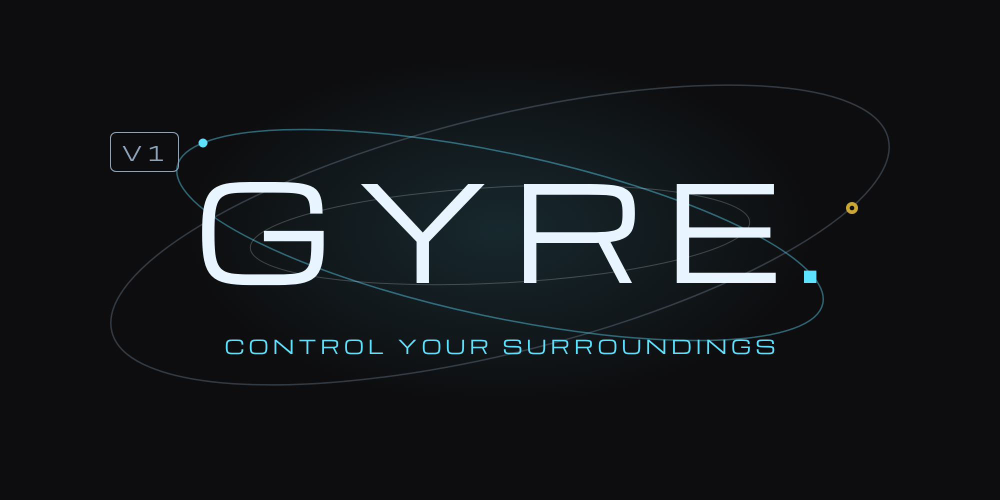
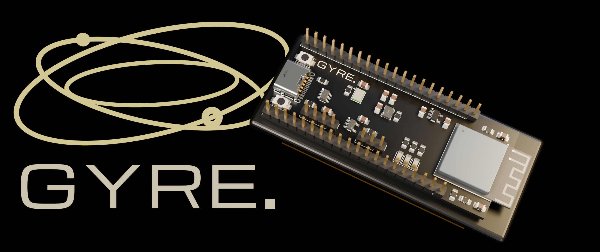
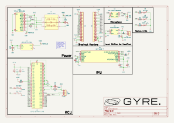
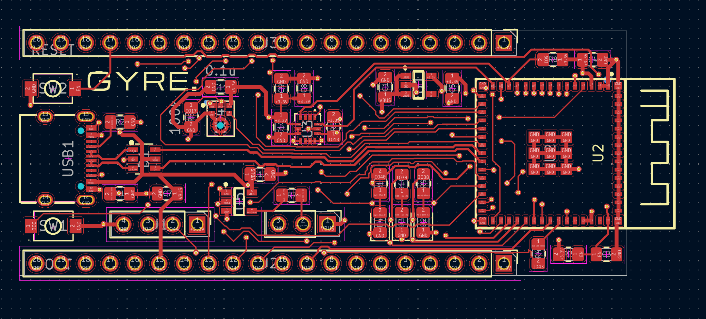
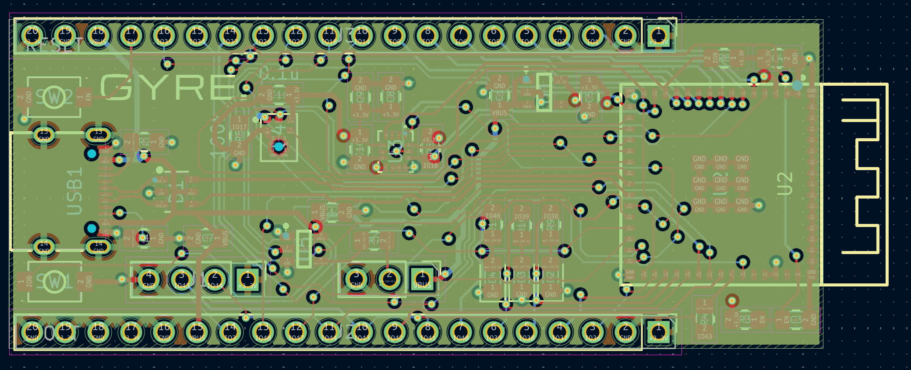
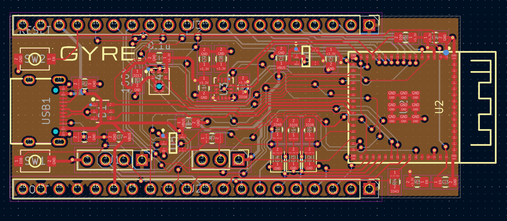
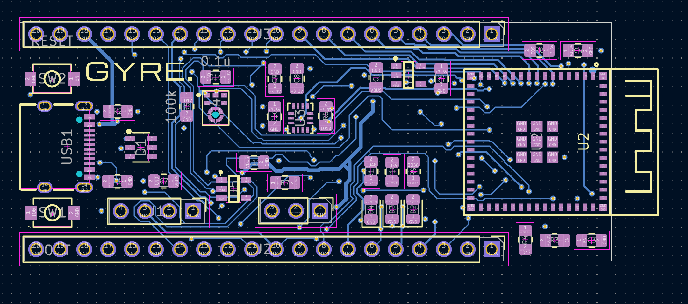
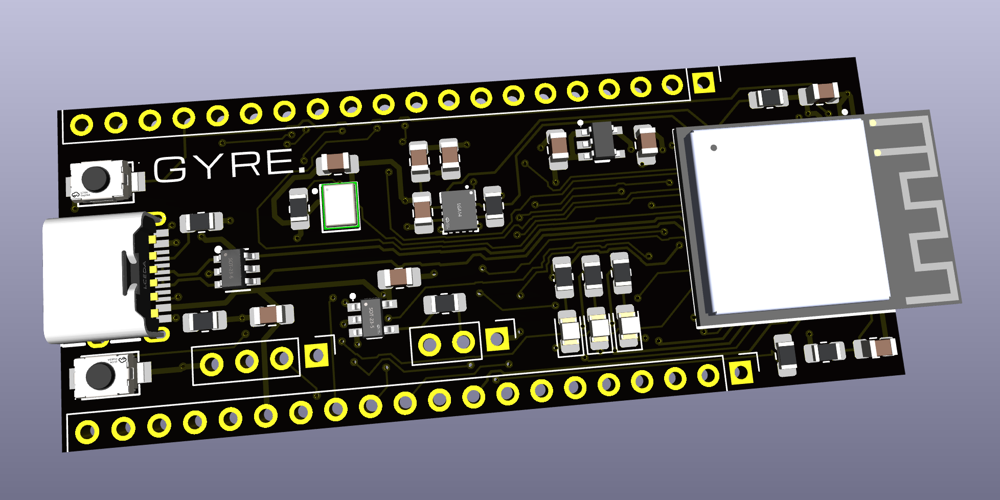
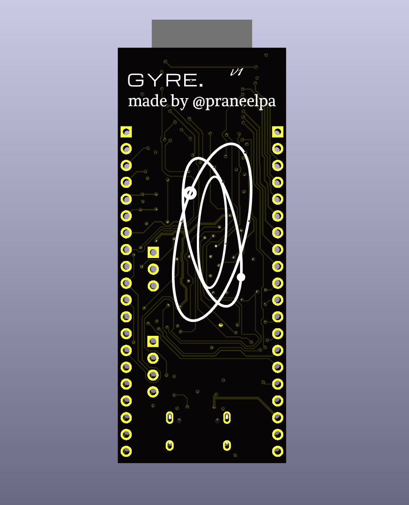

<h1 align="center">
   
  
   
  Gyre V1
   
</h1>

<h4 align="center">
  An ESP32-S3 development board with a live 3D orientation view and voice control for LED strips!
</h4>

  
  

  

> **🚧 Work in progress:** Gyre is in the design stage. The PCB routing has been completed, but nothing has been built or tested yet.

## Features

- **ESP32-S3-MINI-1** module with WiFi, Bluetooth and native USB
- **Live 3D view** - a 6-axis IMU drives a web page that rotates a 3D model of the board in real time, over USB
- **Voice control** - an I2S microphone (ICS-43434) and a small on-device model that listens for commands and controls an external NeoPixel LED strip
- **Raspberry Pi Pico form factor** (21 x 51 mm) with Pico-style 2.54 mm pin headers
- **Still a normal ESP32** - every usable GPIO goes to the headers, so blinking an LED or flashing your own firmware works as usual. Anything onboard that uses a pin has a solder jumper, so you can free the pin
- **USB-C** for power, programming and data
- **BOOT and RESET buttons**
- **Three status LEDs** - PWR, USR (for your own code) and ACT (blinks on activity)
- **4-layer PCB** with a black solder mask and gold (ENIG) pads

## Functionality

### Live 3D view

1. The IMU measures the board's motion.
2. The ESP32 combines the readings into an orientation and sends it over USB serial.
3. A web page in Chrome or Edge reads the serial port (Web Serial) and rotates a 3D model of the board to match.

There's no driver or app to install. The IMU has no compass, so left-right turning (yaw) will slowly drift. That's a known limit of this kind of sensor.

### Voice control

1. The microphone sends audio to the ESP32 over I2S.
2. A small model running on the ESP32 listens for trained words such as "on", "off", colors and brightness levels.
3. Recognized words are combined into a command, for example "blue lights".
4. The ESP32 sends the command to the LED strip through a level shifter on the data line.

The strip is a separate part and has its own 5 V supply. Gyre only sends the data signal, because a room-sized strip can draw far more current than USB provides. The model is trained on a fixed set of words, so it works best for the voice it was trained on.

## PCB

Designed in KiCad. The board uses a 4-layer stackup (SIG/GND/PWR/SIG) with a black solder mask, gold (ENIG) pads and white silkscreen.

### Schematic

### PCB Layers

**Layer 1 (F.Cu):**

**Layer 2 (Ground):**

**Layer 3 (+3.3V):**

**Layer 4 (B.Cu):**

**Front View:**

**Back View:**

### BOM

| Designator | Footprint | Qty Per Board | Order Qty | Value | Price | LCSC Part |
|---|---|---|---|---|---|---|
| C1 | 0805 | 1 | 20 | 10u | $0.4220 | [C1713](https://www.lcsc.com/product-detail/C1713.html) |
| C10, C11, C12, C4, C7 | 0805 | 5 | 20 | 0.1u | $0.2780 | [C49678](https://www.lcsc.com/product-detail/C49678.html) |
| C3 | 0805 | 1 | 20 | 1u | $0.5240 | [C24123](https://www.lcsc.com/product-detail/C24123.html) |
| C5 | 0805 | 1 | 10 | 22u | $0.2190 | [C29277](https://www.lcsc.com/product-detail/C29277.html) |
| C8 | 0805 | 1 | 100 | 10n | $0.6600 | [C282728](https://www.lcsc.com/product-detail/C282728.html) |
| C9 | 0805 | 1 | 20 | 2.2u | $0.9680 | [C1731](https://www.lcsc.com/product-detail/C1731.html) |
| D1 | SOT-23-6_L2.9-W1.6-P0.95-LS2.8-BL | 1 | 5 | USBLC6-2SC6 | $0.7680 | [C7519](https://www.lcsc.com/product-detail/C7519.html) |
| D2 | 0805 | 1 | 50 | ACT red | $0.6300 | [C84256](https://www.lcsc.com/product-detail/C84256.html) |
| D3 | 0805 | 1 | 100 | USR blue | $0.5900 | [C7496833](https://www.lcsc.com/product-detail/C7496833.html) |
| D4 | 0805 | 1 | 50 | VOICE white | $0.4150 | [C55072219](https://www.lcsc.com/product-detail/C55072219.html) |
| J1, J2, J3, J4 | PinHeaders_1x40_P2.54mm_Vertical | 2 | 5 | Conn_01x40 | $0.8160 | [C2337](https://www.lcsc.com/product-detail/C2337.html) |
| R1, R2 | 0805 | 2 | 100 | 5.1K | $0.2900 | [C27834](https://www.lcsc.com/product-detail/C27834.html) |
| R10, R11 | 0805 | 2 | 100 | 100 | $0.3500 | [C105577](https://www.lcsc.com/product-detail/C105577.html) |
| R3, R6, R8 | 0805 | 3 | 100 | 10k | $0.3200 | [C17414](https://www.lcsc.com/product-detail/C17414.html) |
| R4 | 0805 | 1 | 100 | 499 | $0.2300 | [C2933453](https://www.lcsc.com/product-detail/C2933453.html) |
| R5 | 0805 | 1 | 100 | 100k | $0.3600 | [C149504](https://www.lcsc.com/product-detail/C149504.html) |
| R7, R9 | 0805 | 2 | 100 | 330 | $0.2500 | [C2930157](https://www.lcsc.com/product-detail/C2930157.html) |
| SW1 | SW-SMD_L3.9-W2.9-LS4.8 | 1 | 5 | BOOT | $0.4295 | [C596279](https://www.lcsc.com/product-detail/C596279.html) |
| SW2 | SW-SMD_L3.9-W2.9-LS4.8 | 1 | 5 | RESET | $0.4295 | [C596279](https://www.lcsc.com/product-detail/C596279.html) |
| U1 | SOT-25-5_L2.9-W1.6-P0.95-LS2.8-BL | 1 | 5 | AP2112K-3.3TRG1 | $0.8415 | [C51118](https://www.lcsc.com/product-detail/C51118.html) |
| U2 | BULETM-SMD_ESP32-S3-MINI-1-N8 | 1 | 1 | ESP32-S3-MINI-1-N8 | $4.7617 | [C2913206](https://www.lcsc.com/product-detail/C2913206.html) |
| U3 | LGA-14_L3.0-W2.5-P0.50-TL | 1 | 2 | ICM-42688-P | $3.6600 | [C54308212](https://www.lcsc.com/product-detail/C54308212.html) |
| U4 | MIC-SMD_6P-L3.5-W2.7-P0.90-BL | 1 | 1 | ICS-43434_C5656610 | $4.2908 | [C5656610](https://www.lcsc.com/product-detail/C5656610.html) |
| U5 | SOT-25-5_L2.9-W1.6-P0.95-LS2.8-BL | 1 | 1 | 74AHCT1G125GV | $0.0734 | [C52140417](https://www.lcsc.com/product-detail/C52140417.html) |
| USB1 | USB-C-SMD_TYPE-C-16PIN-2MD-073 | 1 | 20 | TYPE-C 16PIN 2MD | $1.3900 | [C2765186](https://www.lcsc.com/product-detail/C2765186.html) |

## Credits

This project uses:

- [KiCad](https://www.kicad.org/)
- [Espressif](https://www.espressif.com/) for the ESP32-S3 module and its hardware design guidelines

---

> GitHub [@praneelpa](https://github.com/praneelpa) ·
> MIT License
