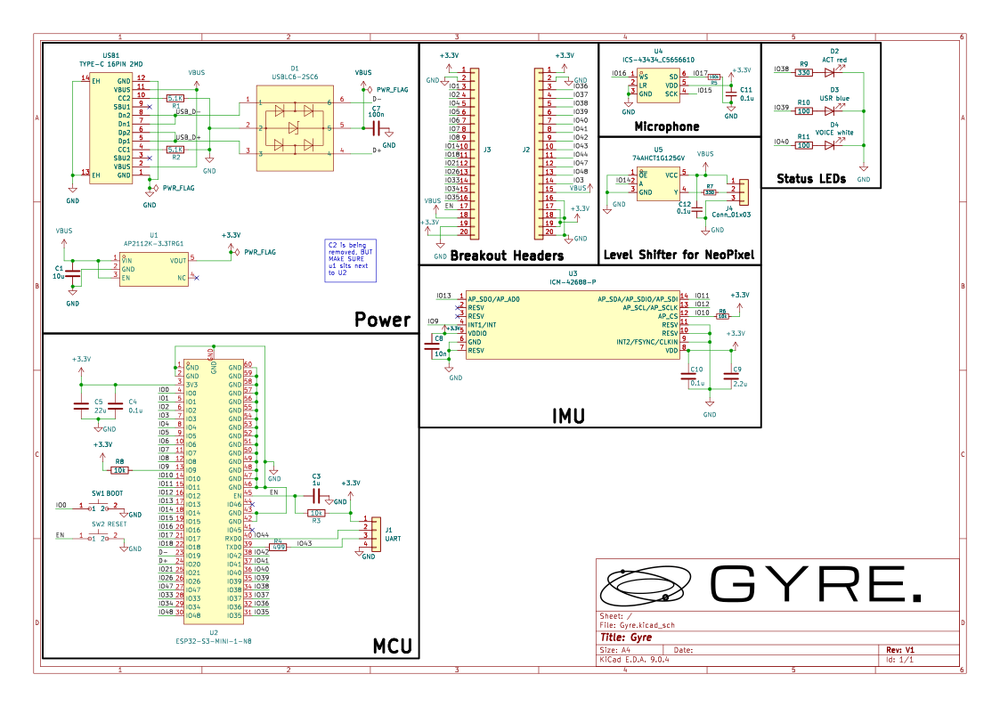

<h1 align="center">
   
  
   
  Gyre V1
   
</h1>

<h4 align="center">
  A Raspberry Pi Pico-sized ESP32-S3 development board with a live 3D orientation view and voice control for LED strips!
</h4>

  
  

  

> **🚧 Work in progress:** Gyre is in the design stage. The schematic is being drawn and nothing has been built or tested yet, so everything below describes the plan for V1.

## Features

- **ESP32-S3-MINI-1** module with WiFi, Bluetooth and native USB
- **Live 3D view** - a 6-axis IMU drives a web page that rotates a 3D model of the board in real time, over USB
- **Voice control** - an I2S microphone (ICS-43434) and a small on-device model that listens for commands and controls an external NeoPixel LED strip
- **Raspberry Pi Pico form factor** (21 x 51 mm) with Pico-style 2.54 mm pin headers
- **Still a normal ESP32** - every usable GPIO goes to the headers, so blinking an LED or flashing your own firmware works as usual. Anything onboard that uses a pin has a solder jumper, so you can free the pin
- **USB-C** for power, programming and data
- **BOOT and RESET buttons**
- **Three status LEDs** - PWR, USR (for your own code) and ACT (blinks on activity)
- **4-layer PCB** with a black solder mask and gold (ENIG) pads

## Functionality

### Live 3D view

1. The IMU measures the board's motion.
2. The ESP32 combines the readings into an orientation and sends it over USB serial.
3. A web page in Chrome or Edge reads the serial port (Web Serial) and rotates a 3D model of the board to match.

There's no driver or app to install. The IMU has no compass, so left-right turning (yaw) will slowly drift. That's a known limit of this kind of sensor.

### Voice control

1. The microphone sends audio to the ESP32 over I2S.
2. A small model running on the ESP32 listens for trained words such as "on", "off", colors and brightness levels.
3. Recognized words are combined into a command, for example "blue lights".
4. The ESP32 sends the command to the LED strip through a level shifter on the data line.

The strip is a separate part and has its own 5 V supply. Gyre only sends the data signal, because a room-sized strip can draw far more current than USB provides. The model is trained on a fixed set of words, so it works best for the voice it was trained on.

## PCB

Designed in KiCad. The board uses a 4-layer stackup (SIG/GND/PWR/SIG) with a black solder mask, gold (ENIG) pads and white silkscreen.

### Schematic

### PCB Layers

**Layer 1 (Signal):**

**Layer 2 (Ground):**

**Layer 3 (Power):**

**Layer 4 (Signal):**

**Front:**

**Back:**

### JLCPCB Order

## Credits

This project uses:

- [KiCad](https://www.kicad.org/)
- [Espressif](https://www.espressif.com/) for the ESP32-S3 module and its hardware design guidelines

---

> GitHub [@praneelpa](https://github.com/praneelpa) ·
> MIT License
